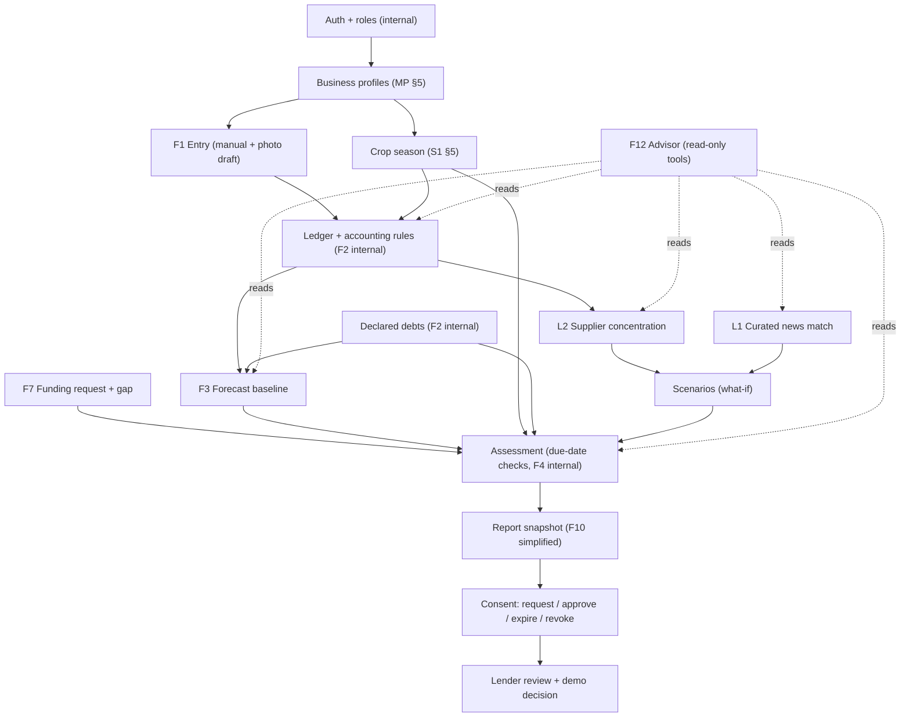

# MVP SCOPE AND SOURCE MAPPING

**Document ID:** BB-DOC-01 · **Version:** 1.0 (12 Nov 2026)
**Purpose:** Show exactly how the original Bonik Bondhu concept (S1, S2, S5, S6) maps to the reduced hackathon MVP required by MP. Source IDs and tags are defined in `06_Handoff/DECISIONS_ASSUMPTIONS_AND_BACKLOG.md` §0.

---

## 1. What we preserved from the original concept

| Preserved principle | Source |
|---|---|
| Problem: irregular collections, existing (often informal) debt and outside disruptions can misalign with fixed repayments | S1 §1.1, §1.2; S2 "Problem" |
| Thesis wording "Lenders decide; Bonik Bondhu does not issue credit or predict actual default without outcome data" | S1 §1.1 |
| Operating rule: "AI reads, predicts and explains. Code calculates every money figure. Humans confirm uncertain data and make lending decisions." | S1 §8 |
| Accounting rules: baki ≠ cash, loan ≠ sales, principal ≠ expense, household withdrawals separate | S1 F2, Appendix A4 |
| Funding gap and affordability are separate questions | S1 F7, Appendix A2; MP §6 F7 |
| Missing information produces an inconclusive result, never a fabricated positive | S1 §1.1, Appendix A4; MP §3 |
| News suggests scenarios; it never proves harm to a borrower | S1 L1 guardrail; MP §6 L1 |
| Consent-scoped, expiring, revocable, logged lender access | S1 F10, §7 |
| CIB stays with the lender; no bureau connector | S1 F9, §11 |
| Honesty labels: working vs simulated vs planned | S1 header labels, §13.1; S5 "Three rules" |

---

## 2. Feature-by-feature mapping

Legend — **IN**: built in MVP · **SIMPLIFIED**: built in reduced form · **INTERNAL**: minimal supporting logic, not a headline feature · **DEFERRED**: backlog (`BL-xx`) · **EXCLUDED**: will not be built for this product stage.

### 2.1 Core engine F1–F12 (S1 §4)

| ID | Original definition (S1) | MP priority | MVP disposition | What exactly is built | Decision refs |
|---|---|---|---|---|---|
| F1 | Easy Entry: typing, voice, receipt/khata photo, bKash/Nagad/bank statement; evidence states; owner confirms | Must Have (MP §6) | **SIMPLIFIED** | Structured manual entry (shop daily/weekly, farm seasonal); optional receipt photo → AI draft → user edits and confirms; evidence `declared` / `document_attached`; duplicate warning | DEC-07, DEC-08, DEC-25, SUG-28; BL-02, BL-03 |
| F2 | Money & Debt picture with strict accounting | Not in six; required foundation (MP §7) | **INTERNAL** | Ledger, money summary, receivables/payables totals, declared debts list | DEC-27, DEC-37 |
| F3 | Cash-flow forecast 7/30/60/90 days, ranges or "insufficient history" | Must Have | **IN (baseline)** | Rolling weekly baseline expected/low/high; separate collections/payments display; known debt installments; insufficient-history state | DEC-09, DEC-33, SUG-07 |
| F4 | Shortfall Risk (Monte Carlo) | Not in six | **INTERNAL (deterministic)** / Monte Carlo **DEFERRED** | Daily projection checked at each due date, base low case + explicit scenarios | DEC-12; BL-04 |
| F5 | Business Health card | Not in six | **DEFERRED** (record coverage shown) | Weeks-with-records count only | DEC-13; BL-05 |
| F6 | Repayment Gate (no universal 75%) | Not in six | **DEFERRED** | Obligations displayed and included in affordability | DEC-14; BL-06 |
| F7 | Funding Gap + Purpose Cost Check + "can you sell it?" | Must Have | **SIMPLIFIED** | Purpose text → (optional AI) item list → user confirms items, prices, price-source type & date; gap formula; request−gap explanation prompt. "Can you sell it" check **DEFERRED** (needs stock-turnover data) | DEC-35, DEC-36, SUG-11 |
| F8 | Safe loan size + shaped planner (optimizer) | Not in six | **DEFERRED**; owner-entered terms tested | Equal-installment or single-payment proposal tested at due dates | DEC-11, DEC-28; BL-07 |
| F9 | Capital Use & Repayment History | Not in six | **DEFERRED** | — | BL-08 |
| F10 | Loan-Ready Report + consent sharing + signed snapshot | Required support (MP §7 "consent-based report sharing") | **SIMPLIFIED** | Section-scoped snapshot + SHA-256, request/approve/expire/revoke, read audit | DEC-18, DEC-19, DEC-31; BL-09 |
| F11 | Early Warning | Not in six | **DEFERRED** | — | BL-10 |
| F12 | Voice AI Advisor, Bangla/English, tool calls, RAG help | Must Have, simplified | **SIMPLIFIED** | Text chat, bilingual, read-only profile-scoped tools, static help topics, numeric grounding check, non-LLM fallback | DEC-17, SUG-23; BL-02, BL-16 |

### 2.2 Intelligence layers L1–L3 (S1 §6)

| ID | Original | MP priority | MVP disposition | What exactly is built | Refs |
|---|---|---|---|---|---|
| L1 | News Risk Radar: Bangla/English feeds + GDELT, LLM classification, location extraction, de-dup, scenario proposal | Must Have, simplified | **SIMPLIFIED** | Curated `news_events` set (team-entered, real with link, or labelled DEMO); match by district/upazila/sector/commodity/supplier district; show source, date, location, relevance reason, single-source vs corroborated; propose scenario that owner must confirm | DEC-15, DEC-30, SUG-12; BL-11 |
| L2 | Supply Network Risk: Stage 1 concentration + shock scenarios; Stage 2 GNN | Must Have, simplified | **SIMPLIFIED (Stage 1)** | Supplier list; purchase share from linked purchases or declared share; high-dependency flag; 7/14-day delay and 15% input-price scenarios | DEC-16, DEC-26, SUG-09, SUG-10; BL-12 |
| L3 | Private Revenue Proof (ZKP) | Not in six | **DEFERRED** | — | BL-13 |

### 2.3 Seasonal producer mode (S1 §5)

| Item | MVP disposition | Refs |
|---|---|---|
| Crop season (crop, variety, season, area+unit, sowing, expected harvest, costs, sales) | **IN** | DEC-05, SUG-14 |
| Crop income range low/expected/high | **IN** using owner-entered output & price ranges (no BBS/DAM data available) | ASM-02, GAP-03 |
| Break-even price, loan-cover price | **IN** (formula SUG-13) | SUG-13 |
| Season loan journey stages 1–4 | Stages 1, 2 (cost entry), 4 (record sale) **IN**; stage 3 "sell now vs wait" **DEFERRED** | S1 §5.1 |
| Dealer credit as debt | **IN** (lender type `dealer_credit`) | S1 §5.1 |
| Poultry, fish, cattle | **DEFERRED** | BL-14 |
| Farmer Buy/Sell page (MP request) | **DEFERRED** (design in BL-01) | DEC-06 |

### 2.4 Users, registration, lender portal

| Item | Source | MVP disposition |
|---|---|---|
| Registration fields | MP §8 (overrides S1 §3) | Full name, phone, email, password only. Phone + password login. |
| Progressive profile questions | S1 §3 table | Collected in profile setup and financing wizard, only when needed |
| OTP, email verification, password reset | MP §8 | **EXCLUDED** for MVP (BL-17) |
| NID | MP §8 | **EXCLUDED** (DEC-20) |
| Multi-profile per user | MP §5 | **IN** (DEC-04) |
| Platform admin | S1 §2 | CLI commands only (DEC-03, DEC-24) |
| Lender portal case file (11 sections in S1 §7) | S1 §7 | Sections 1, 2, 5 (simplified), 6, 7 (base + scenarios, no shaped schedule), 8, 11 (no PDF) **IN**; 3, 4, 9, 10 **DEFERRED** |
| Lender decision | MP §4C; S1 §7 | Officer records demo decision + reason; no disbursement |

### 2.5 Items EXCLUDED at this stage (from S1 §12.1 "Do not build in round one" and MP §17)

Inventory ERP, real-time lender APIs, national SME graph, cross-bank federated learning, official CIB pull, automatic loan approval, blockchain, production underwriting, legal-compliance claims, real loan disbursement or fund transfer, custom foundation model training, multi-agent frameworks, microservices/Kubernetes.

---

## 3. Feature dependencies (why "internal" items exist)

Key dependency facts:
1. F3 is useless without a correct ledger (MP §7) → ledger built in Phase 2 before forecast (Phase 3).
2. The assessment needs F3 (shop) **or** a season plan (farm), plus declared debts, household withdrawal and a funding request.
3. L1 and L2 only add **what-if scenarios** to an existing assessment (DEC-30). If L1/L2 fail, the assessment still works.
4. F12 has no write access; if the LLM is down, every other feature works (DEC-22).
5. The lender sees only a snapshot created at consent approval (DEC-31).

---

## 4. Simplified feature names ↔ original names

| MP name | Original S1 name |
|---|---|
| F1 Financial Extraction / Easy Entry | F1 Easy Entry with evidence states |
| F3 Cash-Flow Forecasting | F3 Cash-Flow Forecast |
| F7 Purpose Understanding / Funding Gap | F7 Funding Gap + Purpose Cost Check |
| L1 News Risk Radar | L1 News Risk Radar (NLP) |
| L2 Supplier Intelligence | L2 Supply Network Risk (graph, GNN) |
| F12 Financial AI Advisor | F12 Voice AI Advisor |
| "Financial assessment" (MP §3, §14) | Combination of F4 (deterministic part), F7 and S1 Appendix A2 capacity test |
| "Report / consent sharing" (MP §7) | F10 Loan-Ready Report and consent sharing |

---

## 5. Scope guardrails for the team

1. A feature not listed as IN/SIMPLIFIED/INTERNAL above is **not built** without an approved change to this file.
2. Every screen must call a working endpoint (MP §17 rule 10). Screens for deferred items are not created.
3. If Phase 5 (lender) is late, AI (Phase 6) is cut before the lender flow (DEC-23; S1 §12.2 kill switch logic).
4. Every number shown in the demo comes from the running system or is labelled DEMO/illustrative (S5 "Three rules").
