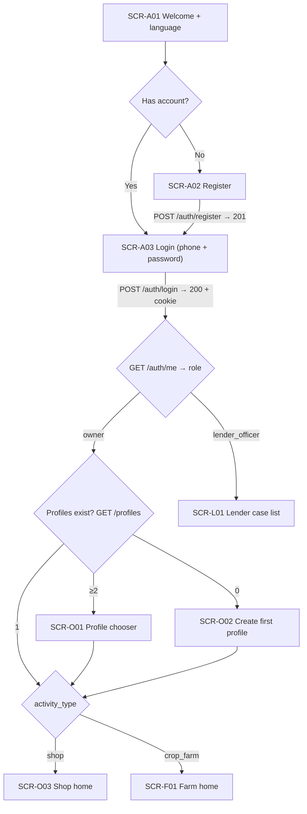
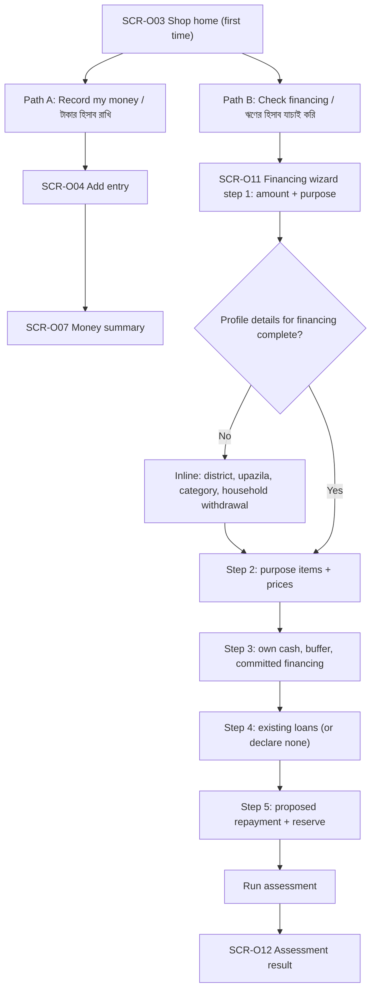
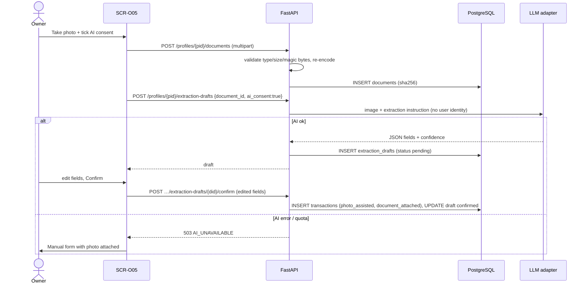
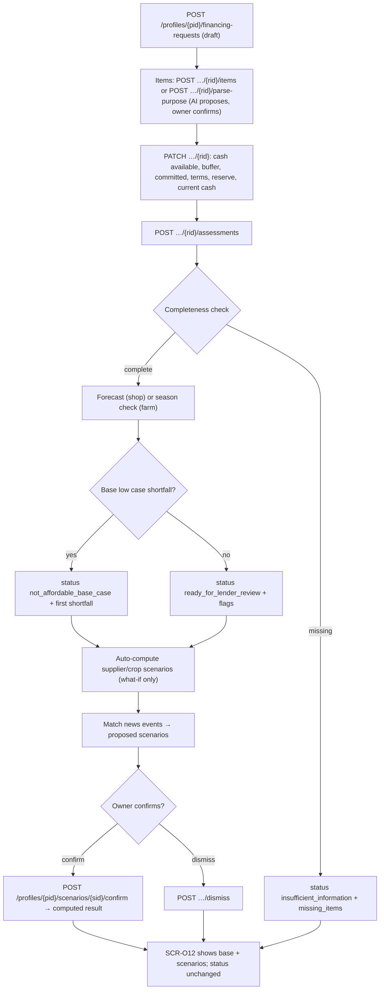
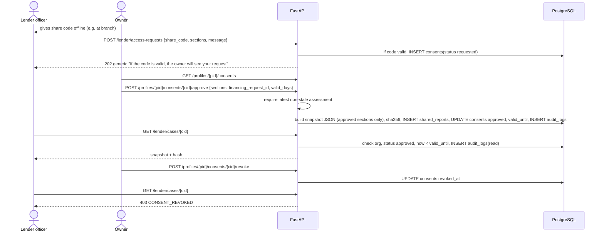
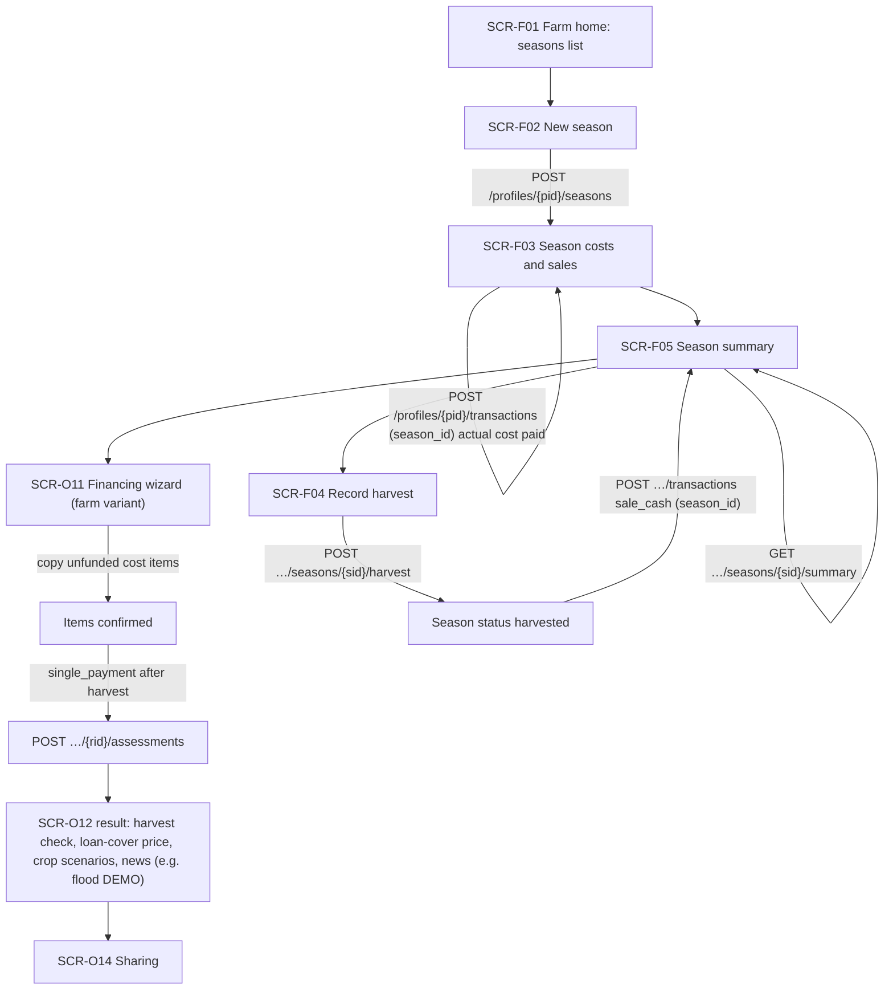
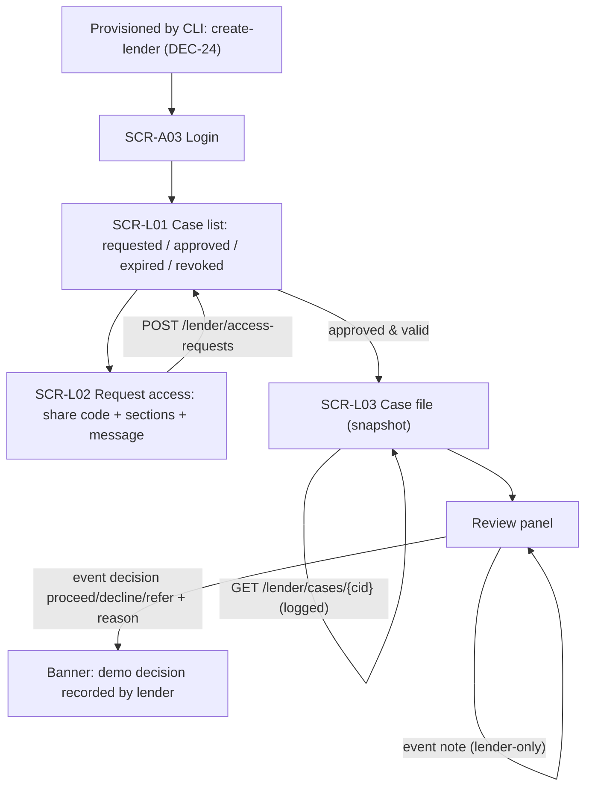
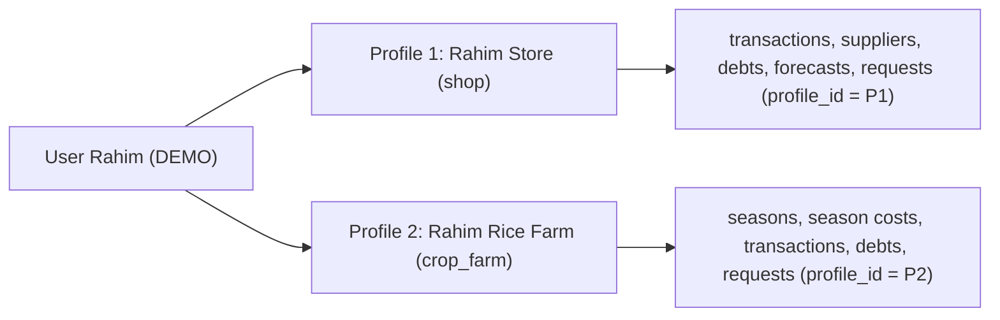

# APP FLOW — Bonik Bondhu Hackathon MVP

**Document ID:** BB-DOC-03 · **Version:** 1.0 (12 Nov 2026)
**Depends on:** `PRD.md` (FR IDs), `UI_UX_SPECIFICATION.md` (screen IDs `SCR-*`), `API_SPECIFICATION.md` (endpoints, base path `/api/v1`)

All endpoints below are relative to `/api/v1`. `{pid}` = profile id, `{rid}` = financing request id, `{aid}` = assessment id, `{cid}` = consent id.

---

## 1. Role routing after login

Rules: role comes only from the server (`/auth/me`), never from the URL or local storage `[SRC: MP §13]`. A lender never sees owner routes; an owner never sees `/lender` routes (FR-LEN-07).

---

## 2. Flow A — Shop owner

### 2.1 First-time experience (Path A / Path B)

Path A never forces financing fields (FR-PROF-06). Path B collects them progressively at the step where they are needed `[SRC: MP §8; S1 §3]`.

### 2.2 Daily / weekly entry → summary (first vertical slice)

| # | Screen | Frontend action | Endpoint | DB operation | Resulting state |
|---|---|---|---|---|---|
| 1 | SCR-O03 | Tap "Sale (cash)" quick button | — | — | SCR-O04 opens with type preset |
| 2 | SCR-O04 | Enter amount 8,500, date today, Save | `POST /profiles/{pid}/transactions` (with `client_request_id`) | INSERT `transactions` (status `confirmed`, evidence `declared`); bump `data_version` (no audit row: ledger writes are not security events) | Toast "Saved"; Home shows today's total |
| 3 | SCR-O04 | Same values again within the day | `POST …/transactions` → 409 `POSSIBLE_DUPLICATE` | none | Dialog "Looks like an entry you already saved. Save again?" |
| 4 | SCR-O06 | Open entry → "Void" + reason | `POST /profiles/{pid}/transactions/{tid}/void` | UPDATE status `voided`, `void_reason` | Entry greyed; excluded from totals |
| 5 | SCR-O07 | Choose "This month" | `GET /profiles/{pid}/summary?from=…&to=…` | SELECT aggregates (confirmed only) | Correct totals per FR-LED-08 |

### 2.3 Receipt photo → confirmed entry (F1 AI)

### 2.4 Suppliers and debts

| # | Screen | Action | Endpoint | DB | Result |
|---|---|---|---|---|---|
| 1 | SCR-O08 | Add supplier "Supplier A", goods "rice, oil", district | `POST /profiles/{pid}/suppliers` | INSERT `suppliers` | Listed |
| 2 | SCR-O04 | Purchase entry → choose supplier | `POST …/transactions` (`supplier_id`) | INSERT with FK | Counts toward share |
| 3 | SCR-O08 | View dependency | `GET /profiles/{pid}/supplier-concentration` | SELECT linked purchases, last 8 weeks | Shares + flag + basis (linked/owner-reported) |
| 4 | SCR-O09 | Add MFI loan details | `POST /profiles/{pid}/debts` | INSERT `debt_facilities` | Listed with next due |
| 5 | SCR-O09 | "I have no current loans" | `POST /profiles/{pid}/debts/declare-none` | UPDATE `business_profiles.no_debt_declared_at` | Requirement satisfied |

### 2.5 Forecast

| # | Screen | Action | Endpoint | DB | Result |
|---|---|---|---|---|---|
| 1 | SCR-O10 | Open / tap "Update forecast" | `POST /profiles/{pid}/forecasts` | SELECT confirmed txns (8-week window); INSERT `forecast_runs` | Status `ok` with ranges, or `insufficient_history` "2 of 4 weeks recorded" |
| 2 | SCR-O10 | Revisit | `GET /profiles/{pid}/forecasts/latest` | SELECT | Shows run date; "Update" if older than latest entry |

### 2.6 Financing request → assessment → scenarios → news

| # | Screen | Action | Endpoint | DB operations | Resulting state |
|---|---|---|---|---|---|
| 1 | SCR-O11 s1 | Amount 200,000, purpose "stock for Eid" | `POST /profiles/{pid}/financing-requests` | INSERT `financing_requests` (draft) | Wizard step 2 |
| 2 | SCR-O11 s2 | Tap "Help me list items" | `POST …/{rid}/parse-purpose` | INSERT `financing_request_items` with `ai_proposed=true, confirmed=false`; INSERT `ai_interactions` | Items shown as suggestions |
| 3 | SCR-O11 s2 | Edit price, choose source "Supplier quote", date | `PATCH …/{rid}/items/{iid}` (`confirmed=true`) | UPDATE item | Item counts in gap |
| 4 | SCR-O11 s3–s5 | Fill remaining fields | `PATCH …/{rid}` | UPDATE request; previous assessment `is_stale=true` | Gap preview |
| 5 | SCR-O11 s5 | "Check" | `POST …/{rid}/assessments` | INSERT `forecast_runs` (if needed), `financial_assessments`, `risk_scenarios` | SCR-O12 |
| 6 | SCR-O12 | Request > gap → enter explanation | `PATCH …/{rid}` (`over_request_explanation`) | UPDATE | Flag shows "explained" |
| 7 | SCR-O12 news tab | Confirm "7-day delay from road blockade (DEMO)" | `POST /profiles/{pid}/scenarios/{sid}/confirm` | UPDATE scenario status, result JSON | Scenario card shows result |

### 2.7 Consent sharing (owner side)

---

## 3. Flow B — Crop farmer

| # | Screen | Action | Endpoint | DB | Result |
|---|---|---|---|---|---|
| 1 | SCR-F02 | Crop "Rice", season "Boro", area 150, unit "decimal", sowing, expected harvest, output range, price range | `POST /profiles/{pid}/seasons` | INSERT `farming_seasons` (`area_acres` computed = 1.5) | Season card |
| 2 | SCR-F02 | Unit "bigha" without factor | same | none → 422 `BIGHA_FACTOR_REQUIRED` | Field error "এক বিঘা = কত শতাংশ লিখুন" |
| 3 | SCR-F03 | Add plan items: fertilizer 18,000 … | `POST …/seasons/{sid}/cost-items` | INSERT `season_cost_items` | Planned total 65,000 |
| 4 | SCR-F03 | "Paid" seed 4,500 | `POST /profiles/{pid}/transactions` (`purchase_cash`, `season_id`, `season_cost_item_id`) | INSERT txn | Actual paid 4,500 |
| 5 | SCR-F05 | Open summary | `GET …/seasons/{sid}/summary` | SELECT + compute | Income range 75,600 / 105,600 / 131,250; break-even 19.70/kg |
| 6 | SCR-F04 | Harvest 3,100 kg on date | `POST …/seasons/{sid}/harvest` | UPDATE season | status `harvested` |
| 7 | SCR-O04 | Sale 3,100 kg × 31 | `POST …/transactions` (`sale_cash`, `season_id`) | INSERT | Season actual sales updated |

Farmers never see the daily forecast screen (FR-SEA-08). Buy/Sell is **not** in the MVP (DEC-06).

---

## 4. Flow C — Lender officer

| # | Screen | Action | Endpoint | DB | Result |
|---|---|---|---|---|---|
| 1 | SCR-L02 | Enter code `7KQ2M-9XA4P` (example), sections | `POST /lender/access-requests` | INSERT `consents` (requested) if code valid | Generic 202 |
| 2 | SCR-L01 | Open approved case | `GET /lender/cases/{cid}` | SELECT snapshot; INSERT `audit_logs` (`consent.read`) | Case file |
| 3 | SCR-L03 | "Request quotation from supplier" | `POST /lender/cases/{cid}/events` `{event_type:"info_request"}` | INSERT `lender_review_events`; UPSERT `lender_reviews.status=info_requested` | Owner sees request on SCR-O14 |
| 4 | SCR-L03 | Decision "refer" + reason | `POST /lender/cases/{cid}/events` `{event_type:"decision"}` | INSERT event; UPDATE review `decision_recorded`; INSERT audit | Banner |

---

## 5. Flow D — Multi-profile user

| # | Screen | Action | Endpoint | Behaviour |
|---|---|---|---|---|
| 1 | Header | Tap profile name → SCR-O01 | `GET /profiles` | List with type icons |
| 2 | SCR-O01 | Choose "Rahim Rice Farm" | none (client sets active `pid` in memory + URL `/p/{pid}/…`) | All subsequent calls use that `pid`; server checks ownership each time |
| 3 | SCR-O01 | "Add another business" | `POST /profiles` | New profile |
| 4 | Advisor | Ask question | `POST /profiles/{pid}/advisor/messages` | Tools read only `pid`'s data |

Data never mixes: every owner query filters by `profile_id` **and** checks `business_profiles.owner_user_id = session user` `[SRC: MP §5]`. Household withdrawal is declared per profile (DEC-37).

---

## 6. Session, logout and expiry

| Event | Behaviour |
|---|---|
| Logout | `POST /auth/logout` → session row revoked, cookie cleared → SCR-A03 |
| Expired session | Any call → 401 `SESSION_EXPIRED` → UI stores nothing sensitive, shows "Please log in again / আবার লগইন করুন" |
| Unsaved wizard data on expiry | Request is saved as draft on each step (`PATCH`), so at most the current step is lost |

---

## 7. Exception flows

| # | Exception | Screen | Trigger / endpoint | System response | User sees (bn / en) | Resulting state |
|---|---|---|---|---|---|---|
| X1 | No financial data | SCR-O07, O10 | `GET …/summary` returns zeros | 200 with `has_data=false` | "এখনও কোনো হিসাব নেই। প্রথম এন্ট্রি দিন।" / "No entries yet. Add your first entry." | Empty state CTA |
| X2 | Insufficient forecast history | SCR-O10, O12 | `POST …/forecasts` | `status=insufficient_history, weeks_with_records=2, required=4` | "পূর্বাভাসের জন্য আরও ২ সপ্তাহের হিসাব দরকার।" | Assessment `insufficient_information` |
| X3 | Incorrect/incomplete entry | SCR-O04 | `POST …/transactions` | 422 field errors | "টাকার পরিমাণ লিখুন" / "Enter an amount" | Nothing saved |
| X4 | Invalid password | SCR-A03 | `POST /auth/login` | 401 `INVALID_CREDENTIALS`; after 5 → 429 | "ফোন নম্বর বা পাসওয়ার্ড ভুল" / "Phone or password is wrong" | Counter increments |
| X5 | API unavailable | any | network error / 5xx | — | "সংযোগ সমস্যা। আবার চেষ্টা করুন।" + retry | No partial writes (transactions are atomic) |
| X6 | AI extraction failure | SCR-O05 | `POST …/extraction-drafts` 503 `AI_UNAVAILABLE` or 422 `EXTRACTION_FAILED` | Draft not created | "ছবি থেকে পড়া যায়নি। নিজে লিখুন।" | Manual form with document attached |
| X7 | Duplicate record | SCR-O04 | 409 `POSSIBLE_DUPLICATE` | Existing entry summary returned | Confirm dialog | Saved only if confirmed |
| X8 | Missing supplier info | SCR-O08, O12 | concentration with no suppliers | `basis=none` | "প্রধান সরবরাহকারী যোগ করুন" | No supplier scenarios |
| X9 | Financing request with inadequate evidence | SCR-O12 | assessment | `insufficient_information` (missing items) or flag `weak_price_evidence` | List of fixes, each linking to the screen | Owner fixes and re-runs |
| X10 | No viable scenario (base shortfall) | SCR-O12 | assessment | `not_affordable_base_case`, first shortfall date/amount | "এই শর্তে <date> তারিখে Tk X কম পড়তে পারে।" + options: lower amount, longer term (≤90 days), different terms from lender | Can still share with lender (honest case) |
| X11 | Lender access without consent | SCR-L03 | `GET /lender/cases/{cid}` with status ≠ approved or other org | 403 `CONSENT_REQUIRED` / 404 | "Access not granted by the applicant" | Audit row `consent.read_denied` |
| X12 | Revoked or expired permission | SCR-L03 | same | 403 `CONSENT_REVOKED` / `CONSENT_EXPIRED` | Message + case moves to "Closed" tab | — |
| X13 | Stale assessment at approval | SCR-O14 | approve | 409 `ASSESSMENT_STALE` | "আগে নতুন করে হিসাব যাচাই করুন" | Approve disabled until re-run |
| X14 | News data unavailable | SCR-O12 | `GET …/news-signals` empty | 200 `[]` | "এই এলাকার কোনো খবর তালিকায় নেই" | Rest of page normal |
| X15 | Advisor limit / LLM down | SCR-O15 | 429 `AI_DAILY_LIMIT` / 503 | Help menu shown | "আজকের প্রশ্নের সীমা শেষ। নিচের বিষয়গুলো দেখুন।" | Deterministic help |
