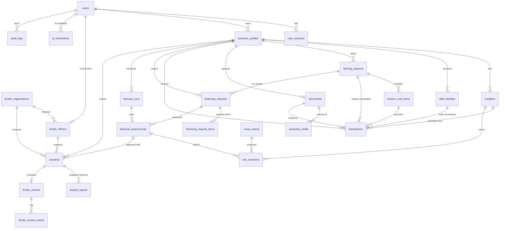

# DATABASE SCHEMA — Bonik Bondhu Hackathon MVP

**Document ID:** BB-DOC-07 · **Version:** 1.0 (12 Nov 2026)
**Files:** `schema.sql` (migration 0001), `seed_demo.sql` (DEMO data)
**Verified:** `schema.sql` and `seed_demo.sql` were executed on PostgreSQL 16 on 12 Nov 2026; 18 constraint negative tests passed (see §8). Seed aggregates equal the golden values in `TESTING_AND_ACCEPTANCE.md` §4.

Database: **PostgreSQL** `[SRC: S1 §8; S2; DEC-01]`. ORM/migrations: SQLAlchemy + Alembic `[SUG-01]`.

---

## 1. Design rules

| Rule | Why | Source |
|---|---|---|
| All owner data hangs off `business_profiles.id` (`profile_id`) | Multi-profile isolation | MP §5 |
| Composite FKs `(profile_id, x_id)` for every child reference | DB itself refuses cross-profile links (defence in depth) | MP §12 `[DERIVED]` |
| Ownership check = `business_profiles.owner_user_id = session.user_id` in the service layer on **every** request | IDOR prevention | MP §12, §13 |
| No hard delete of ledger rows; voiding with reason | Audit trail | S1 A1 `[DERIVED]` |
| Money `NUMERIC(14,2)`, currency `BDT` | Exactness | SUG-06 |
| UUID keys | Non-enumerable ids | SUG-26 |
| `is_demo` on users, profiles, lenders, news | Separate demo from real | MP §12, §18 |
| `audit_logs` append-only (trigger) | Tamper resistance | S1 F10 |
| No passwords/tokens/NID/AI prompt text stored | Minimisation | MP §11, §13; DEC-20; SUG-22 |
| No separate "farm profile" or "farming expense" tables | Avoid unnecessary tables | MP §12; DEC-27 |

---

## 2. ER diagram



---

## 3. Ownership model

```
users (role=owner) 1 ── * business_profiles ── * {suppliers, debt_facilities, farming_seasons,
                                                   season_cost_items, documents, extraction_drafts,
                                                   transactions, financing_requests, financing_request_items,
                                                   forecast_runs, financial_assessments, risk_scenarios, consents}
users (role=lender_officer) 1 ── 1 lender_officers ── * lender_organizations
lender access path: lender_officers.organization_id = consents.lender_organization_id
                    AND consents.status='approved' AND now() < consents.valid_until
                    → shared_reports (latest version) only
```

Repository functions **must** take `(user_id, profile_id)` and join `business_profiles.owner_user_id`. A helper `get_owned_profile(session, profile_id)` returns the profile or raises 404 (FR-PROF-05). Lender repositories take `(officer_user_id, consent_id)` and join `lender_officers.organization_id`.

---

## 4. Accounting effect of `transactions.txn_type` `[SRC: S1 F2, Appendix A4]`

| txn_type | Cash | Sales recorded | Operating cash flow | Receivable | Payable | Notes |
|---|---|---|---|---|---|---|
| `sale_cash` | + | + | + in | | | |
| `sale_credit` | 0 | + | 0 | + | | baki is not cash |
| `receivable_collection` | + | 0 | + in | − | | |
| `purchase_cash` | − | | − out (purchase) | | | stock ≠ COGS |
| `purchase_credit` | 0 | | 0 | | + | |
| `payable_payment` | − | | − out (purchase) | | − | |
| `operating_expense` | − | | − out | | | |
| `loan_received` | + | 0 | 0 | | | financing, not sales |
| `loan_principal_repayment` | − | | 0 | | | reduces debt, not expense |
| `loan_interest_fee_payment` | − | | 0 | | | separate financing cost; future schedule comes from `debt_facilities` |
| `owner_withdrawal` | − | | 0 | | | household; forecast uses declared monthly value (DEC-37) |
| `owner_contribution` | + | 0 | 0 | | | owner money, not income; transfer between own profiles = withdrawal in one + contribution in other |

"Net operating cash" (used by forecast) = operating in − operating out. Financing and owner movements are excluded so they are never double counted with debt schedules or household withdrawals.

---

## 5. Data dictionary

Column-level types/constraints are authoritative in `schema.sql`. Below: purpose, key columns, relationships, indexes, sensitive fields and an example per table.

### 5.1 `users`
- **Purpose:** login identity for owners, lender officers, admins. `[MP §8]`
- **Key columns:** `id UUID PK`; `full_name TEXT`; `phone_e164 TEXT UNIQUE` (pattern `^\+8801[3-9]\d{8}$`, SUG-24); `email TEXT` (lower-case, unique index); `password_hash TEXT` (Argon2id, SUG-02); `role` ∈ owner/lender_officer/admin; `preferred_language` ∈ bn/en; `failed_login_count`, `locked_until` (SUG-05); `is_demo`.
- **Sensitive:** phone, email, password_hash (never returned by API).
- **Example:** `{id: "…", full_name: "Rahim Uddin (DEMO)", phone_e164: "+8801900000001", email: "d1.rahim@demo.invalid", role: "owner", preferred_language: "bn", is_demo: true}`

### 5.2 `user_sessions`
- **Purpose:** server-side sessions; logout/expiry (FR-AUTH-06). `[SUG-03]`
- **Key columns:** `token_sha256 CHAR(64) UNIQUE` (raw token only in cookie), `expires_at`, `revoked_at`, `last_seen_at`. FK `user_id → users`.
- **Index:** active sessions by user.
- **Sensitive:** token hash.

### 5.3 `lender_organizations`, `lender_officers`
- **Purpose:** manually provisioned lender accounts (DEC-24). Officer row links a `users` row (role `lender_officer`) to one organisation.
- **Example:** org `{name: "DEMO Bank Ltd (fictional)", org_type: "bank", is_demo: true}`; officer `{user: Nasrin Officer (DEMO), designation: "SME Officer"}`.

### 5.4 `business_profiles`
- **Purpose:** one shop or crop farm owned by a user (MP §5).
- **Key columns:** `owner_user_id FK users`; `activity_type` ∈ shop/crop_farm; `display_name`; progressive fields `business_category`, `district`, `upazila`, `market_area`; `household_withdrawal_monthly` + `household_declared_at` (DEC-37); `no_debt_declared_at` (FR-DEBT-02); `share_code` (10 chars from `A-H J-N P-Z 2-9`, unique, FR-PROF-07); `data_version BIGINT` (incremented by the service on any change to the profile's assessment inputs; assessments store it to detect staleness, FR-ASM-09).
- **Index:** owner's active profiles.
- **Sensitive:** location; share_code (treat as a secret locator).
- **Example:** `{display_name: "Rahim Store", activity_type: "shop", district: "Dhaka", upazila: "Savar", household_withdrawal_monthly: 15000.00, share_code: "7KQ2M9XA4P", is_demo: true}`

### 5.5 `suppliers`
- **Purpose:** L2 supplier list (DEC-26).
- **Key columns:** `display_name`, `goods_supplied`, `district`, `upazila`, `declared_purchase_share_pct` (fallback when < 2 linked purchases, FR-SUP-03).
- **Sensitive:** third-party names — **never** sent to lenders by name (snapshot uses "Supplier 1/2/3") or to the LLM (advisor tools return labels) `[SRC: S1 L2 privacy]`.
- **Example:** `{display_name: "Supplier A (DEMO wholesaler)", goods_supplied: "rice, oil, lentils", district: "Gazipur", upazila: "Kaliakair"}`

### 5.6 `farming_seasons`
- **Purpose:** crop season plan and outcome (S1 §5; DEC-05).
- **Key columns:** `crop_name`, `variety`, `season_name` ∈ aman/boro/aus/winter_vegetables/other; `area_value`, `area_unit` ∈ acre/decimal/sq_ft/bigha, `decimals_per_bigha` (required for bigha), `area_acres` (service-computed, SUG-14); `sowing_date < expected_harvest_date`; output and price low ≤ expected ≤ high; `status` ∈ planned/growing/harvested/closed; `actual_harvest_date`, `actual_output`.
- **Example:** `{crop_name: "Rice", season_name: "boro", area_value: 150, area_unit: "decimal", area_acres: 1.5, sowing_date: "2027-01-10", expected_harvest_date: "2027-05-05", expected_output_low: 2700, expected_price_low: 28}`

### 5.7 `season_cost_items`
- **Purpose:** planned season costs (budget). Actual payments are `transactions` with `season_id` + `season_cost_item_id` (DEC-27).
- **Key columns:** `category`, `item_name`, `quantity`, `unit`, `unit_cost`, `total_cost` (generated), `price_source_type`.
- **Example:** `{category: "fertilizer", item_name: "Fertilizer (DEMO)", quantity: 1, unit: "lot", unit_cost: 18000, total_cost: 18000}`

### 5.8 `documents`
- **Purpose:** uploaded receipt images (F1). Stored on private disk path `UPLOAD_DIR/<storage_key>` (SUG-18).
- **Key columns:** `storage_key` (random), `mime_type` ∈ image/jpeg, image/png; `size_bytes ≤ 5 MB`; `sha256` (duplicate evidence check); `purpose`.
- **Sensitive:** image content (may show names/phones). Never public URL; served only to the owner via authenticated endpoint.

### 5.9 `extraction_drafts`
- **Purpose:** AI-proposed fields awaiting confirmation (FR-EXT-02). Never counted.
- **Key columns:** `status` ∈ pending/confirmed/discarded/failed; `proposed JSONB` (e.g. `{"txn_type":{"value":"purchase_cash","confidence":0.62}, "amount":{"value":"12450.00","confidence":0.93}}`); `confirmed_transaction_id`.

### 5.10 `debt_facilities`
- **Purpose:** declared existing obligations (S1 §3; S1 §5.1 dealer credit).
- **Key columns:** `lender_type` ∈ bank/mfi/ngo/samity/mohajon/supplier_credit/dealer_credit/other; `lender_label`; `original_principal`; `outstanding_balance` as of `outstanding_as_of`; `installment_amount` + `installment_frequency` ∈ weekly/monthly/single; `next_due_date`; `is_overdue`, `overdue_amount`; `evidence_state`; optional `season_id`.
- **Schedule rule:** installments generated from `next_due_date` until outstanding is exhausted; dates before `as_of` are skipped (owner should update the record) `[DERIVED: S1 F3]`.
- **Example:** `{lender_type: "mfi", lender_label: "DEMO NGO weekly loan", outstanding_balance: 60000, installment_amount: 2500, installment_frequency: "weekly", next_due_date: as_of+3}`

### 5.11 `transactions`
- **Purpose:** the single ledger for shops and farms (MP §8).
- **Key columns:** `txn_type` (12 values, §4); `amount > 0`; `currency='BDT'`; `value_date`; `settlement_date`; optional links `supplier_id` (purchase types only), `debt_facility_id` (loan types only), `season_id`, `season_cost_item_id`, `document_id`; `entry_method` ∈ manual/photo_assisted/seed; `evidence_state` ∈ declared/document_attached; `status` ∈ confirmed/voided (+ `void_reason`, `voided_at`); `duplicate_confirmed`; `client_request_id` (idempotency, unique per profile).
- **Indexes:** `(profile_id, value_date)` for confirmed rows; supplier; duplicate-check `(profile_id, txn_type, amount, value_date)`; season.
- **Example:** `{txn_type: "purchase_cash", amount: 65000.00, value_date: as_of-53, supplier_id: <Supplier A>, entry_method: "seed", evidence_state: "declared", status: "confirmed"}`

### 5.12 `financing_requests`
- **Purpose:** F7 request + owner-entered proposal (DEC-11).
- **Key columns:** `requested_amount`, `purpose_text`, `purpose_category`; gap inputs `associated_expenses`, `liquidity_buffer`, `buffer_justification`, `cash_safely_available`, `committed_financing`; capacity inputs `current_cash_balance` (optional), `minimum_cash_reserve`; proposal `schedule_type`, `installment_count`, `installment_frequency`, `first_due_date`, `interest_fees_total` / `interest_fees_unknown`; `over_request_explanation`; optional `season_id`.
- **Example:** D1 `{requested_amount: 200000, associated_expenses: 10000, liquidity_buffer: 20000, cash_safely_available: 30000, current_cash_balance: 45000, minimum_cash_reserve: 10000, schedule_type: "equal_installments", installment_count: 12, installment_frequency: "weekly", first_due_date: as_of+7, interest_fees_total: 16000}`

### 5.13 `financing_request_items`
- **Purpose:** purpose cost lines with price evidence (S1 F7).
- **Key columns:** `quantity`, `unit`, `unit_price`, `line_total` (generated), `price_source_type`, `price_date`, `price_source_note`, `ai_proposed`, `confirmed` (only confirmed rows count), `source_season_cost_item_id`.

### 5.14 `forecast_runs`
- **Purpose:** stored F3 output (reproducibility).
- **Key columns:** `as_of_date`, `method_version` (`weekly-baseline-v1`), `status` ∈ ok/insufficient_history, `window_weeks`, `weeks_with_records`, `min_weeks_required`, weekly expected/low/high nets, expected collections/payments/purchases, `horizons JSONB` (e.g. `{"7":{"low":"25000.00","expected":"32312.50","known_debt_service":"0.00"}, "30":{…}}`), `assumptions JSONB`, `profile_data_version`.

### 5.15 `financial_assessments`
- **Purpose:** assessment result (MP §3; DEC-10).
- **Key columns:** `status` ∈ insufficient_information/not_affordable_base_case/ready_for_lender_review; `funding_gap`, `purpose_items_total`, `request_minus_gap`; `missing_items JSONB` (codes); `flags JSONB` (codes); `base_result JSONB` (due-date checks or crop check); `explanation JSONB` (formulas, inputs with source tags, parameters, engine version); `inputs_sha256`; `profile_data_version` (stale if ≠ profile's current `data_version`).
- **Missing-item codes:** `debts_not_declared`, `household_withdrawal_not_declared`, `purpose_items_missing`, `gap_inputs_missing`, `terms_incomplete`, `forecast_insufficient_history`, `term_beyond_forecast_horizon`, `season_incomplete`, `repayment_due_before_expected_harvest`, `profile_location_missing`.
- **Flag codes:** `request_exceeds_gap`, `over_request_explained`, `weak_price_evidence`, `high_supplier_dependency`, `scenario_shortfall`, `pre_harvest_cash_shortfall`, `starting_cash_unknown`, `reserve_zero`, `interest_fees_unknown`, `existing_debt_overdue`, `existing_debt_dates_outdated`, `news_signal_single_source`.

### 5.16 `risk_scenarios`
- **Purpose:** what-if runs attached to an assessment (L1/L2; DEC-30).
- **Key columns:** `scenario_type` ∈ supplier_delay/input_price_rise/harvest_price_fall/yield_shortfall; `origin` ∈ auto/news; `news_event_id`; `supplier_id`; `parameters JSONB`; `status` ∈ computed/proposed/dismissed; `result JSONB`.
- **Rule:** `auto` scenarios are computed immediately; `news` scenarios start `proposed` and need owner confirmation (DB CHECK).

### 5.17 `news_events`
- **Purpose:** curated L1 dataset (DEC-15).
- **Key columns:** `headline` (+lang), `summary` (team-written ≤ 500 chars; no article body), `source_name`, `source_url` (required unless DEMO), `published_date`, `event_date`, `event_type` (S1 L1 taxonomy, 8 values), `districts[]`, `upazilas[]`, `sectors[]`, `commodities[]`, `source_count` (≥ 2 = corroborated), `dedup_key UNIQUE`, `is_demo` (DEMO rows must use source name `DEMO (fictional)`), `curated_by`.
- **Index:** GIN on `districts`.

### 5.18 `consents`
- **Purpose:** request/approve/decline/revoke lifecycle (S1 F10; DEC-18).
- **Key columns:** `profile_id`, `lender_organization_id`, `requested_by_user_id`, `requested_sections[]`, `request_message`, `status` ∈ requested/approved/declined/revoked, `approved_sections[]` (must include `profile_summary` and `financing_request`), `financing_request_id`, `assessment_id`, `valid_until`, timestamps. "Expired" is computed (`now() ≥ valid_until`), not stored.
- **Section keys:** `profile_summary`, `money_summary`, `forecast`, `financing_request`, `obligations`, `supplier_risk`, `news_signals`, `season_summary`, `transaction_list`.

### 5.19 `shared_reports`
- **Purpose:** immutable snapshot JSON for each approval/reshare (DEC-19, DEC-31).
- **Key columns:** `consent_id`, `version`, `snapshot JSONB`, `snapshot_sha256` (SHA-256 of canonical JSON: keys sorted, no whitespace, UTF-8).

### 5.20 `lender_reviews`, `lender_review_events`
- **Purpose:** lender workflow (DEC-34). One review per consent; events = status changes, notes (lender-only), info requests (owner-visible), decision.
- **Constraint highlights:** decision requires reason ≥ 5 chars, decided_by, decided_at; note never visible to owner; info_request always visible.

### 5.21 `audit_logs`
- **Purpose:** append-only security/consent log (S1 F10, §11).
- **Actions (minimum):** `auth.register`, `auth.login`, `auth.login_failed`, `auth.logout`, `auth.locked`, `consent.request`, `consent.approve`, `consent.decline`, `consent.revoke`, `consent.reshare`, `consent.read`, `consent.read_denied`, `lender.event`, `lender.decision`, `admin.create_lender`, `admin.reset_password`, `access.denied` (ownership failures).
- **Sensitive:** `ip_sha256` (hashed with server salt), no tokens/passwords.

### 5.22 `ai_interactions`
- **Purpose:** AI usage metadata for caps and debugging (SUG-22). **No content.**

---

## 6. Relationships summary (FK list)

| Child | → Parent | Type |
|---|---|---|
| user_sessions.user_id | users | many-to-one |
| lender_officers.user_id / organization_id | users / lender_organizations | one-to-one / many-to-one |
| business_profiles.owner_user_id | users | many-to-one |
| suppliers, documents, debt_facilities, farming_seasons, transactions, financing_requests, forecast_runs, consents .profile_id | business_profiles | many-to-one |
| season_cost_items (profile_id, season_id) | farming_seasons (profile_id, id) | composite |
| transactions (profile_id, supplier_id / debt_facility_id / season_id / season_cost_item_id / document_id) | respective (profile_id, id) | composite, nullable |
| financing_request_items (profile_id, financing_request_id) | financing_requests | composite |
| financial_assessments (profile_id, financing_request_id / forecast_run_id) | financing_requests / forecast_runs | composite |
| risk_scenarios (profile_id, assessment_id / supplier_id), news_event_id | financial_assessments / suppliers / news_events | composite / simple |
| consents.lender_organization_id, requested_by_user_id, (profile_id, assessment_id) | lender_organizations, lender_officers, financial_assessments | mixed |
| shared_reports.consent_id, lender_reviews.consent_id | consents | many-to-one / one-to-one |
| lender_review_events.review_id | lender_reviews | many-to-one |

---

## 7. Migration strategy `[SUG-01]`

1. `backend/migrations/versions/0001_initial.py` executes `schema.sql` content (Alembic `op.execute`) so the SQL file stays the reviewed source of truth.
2. Every later change = new Alembic revision (`0002_…`), reviewed in PR, applied with `alembic upgrade head`; never edit an applied revision.
3. Demo data is **not** a migration. Load with `python -m app.cli seed-demo` (runs `seed_demo.sql`, then sets demo password hashes).
4. Reset demo before a presentation: `python -m app.cli reset-demo` → deletes rows where `is_demo` (in FK-safe order inside one transaction) then re-seeds. Real (non-demo) rows are untouched. Because `audit_logs` is append-only, demo audit rows remain (they carry demo ids only).
5. Backups (deployment): nightly `pg_dump` of the demo database is sufficient for the hackathon (GAP-07 for host).

---

## 8. Verification performed (12 Nov 2026)

| Check | Result |
|---|---|
| `schema.sql` loads on PostgreSQL 16 with `ON_ERROR_STOP` | ✔ |
| `seed_demo.sql` loads | ✔ |
| D1 weekly net expected/low/high = 32,312.50 / 25,000 / 41,000; D2 = 8,666.67 / 6,000 / 11,000 (6 weeks); D4 = 2 weeks | ✔ matches reference |
| D1 supplier shares 65.0 / 25.0 / 10.0 % | ✔ |
| Funding gaps D1 150,000; D2 70,000; D3 40,000 | ✔ |
| D3 income range 75,600 / 105,600 / 131,250; planned cost 65,000; 1.5 acres | ✔ |
| Rejected by DB (18 cases): cross-profile supplier link, supplier on a sale, zero amount, void without reason, `document_attached` without document, invalid phone, duplicate email, bigha without factor, harvest before sowing, approved consent missing sections, unknown section key, real news without URL, audit UPDATE, audit DELETE, lender decision without reason, lender note visible to owner, unconfirmed non-AI item, auto scenario left "proposed" | ✔ all rejected |

These DB checks complement — never replace — service-layer authorization tests (Security doc §7).

---

## 9. Data retention (MVP)

| Data | Retention | Basis |
|---|---|---|
| Sessions | delete 30 days after expiry | SUG-03 |
| AI metadata | 90 days | SUG-22 |
| Uploaded images | until owner deletes profile (profile deletion = BL-19 admin task) | MP §13 minimal |
| Audit logs | keep for project duration | S1 F10 |
| Demo rows | reset any time | MP §18 |
