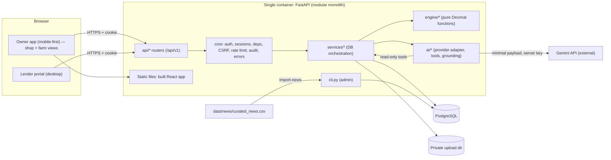
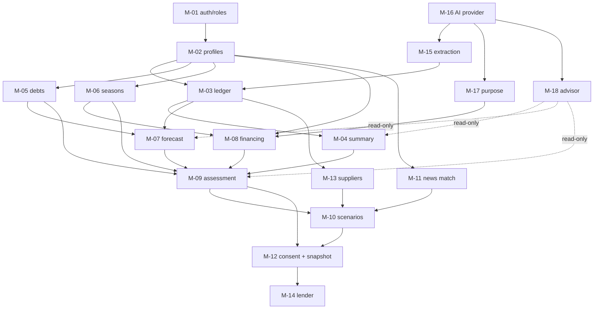
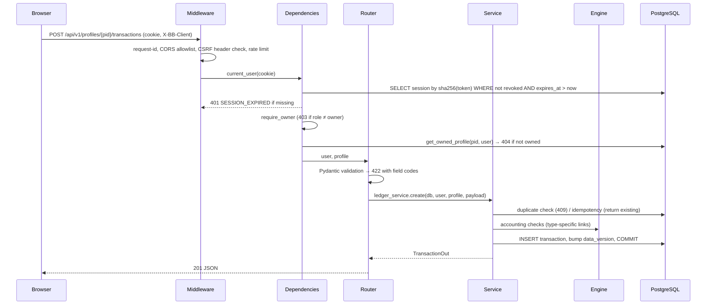
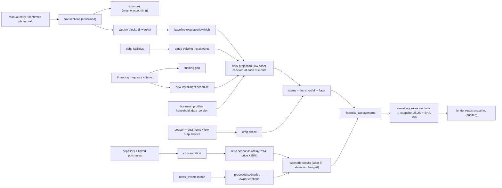
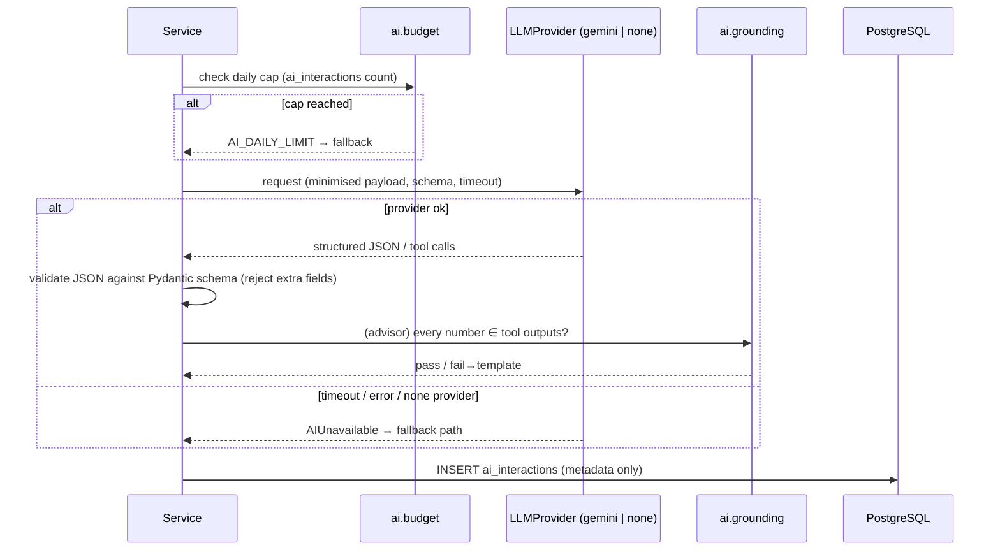

# SYSTEM ARCHITECTURE — Bonik Bondhu Hackathon MVP

**Document ID:** BB-DOC-06 · **Version:** 1.0 (12 Nov 2026)
**Depends on:** `TRD.md`, `DATABASE_SCHEMA.md` · Operating rule: **"AI reads, predicts and explains. Code calculates every money figure. Humans confirm uncertain data and make lending decisions."** `[SRC: S1 §8]`

---

## 1. System components



| Component | Responsibility | Must not |
|---|---|---|
| Owner app | Screens in UI spec, form validation for UX only | Hold secrets, compute authoritative money values, store financial data locally |
| Lender portal | Case list, case file, review panel | Access owner routes |
| `core` | Identity, session, role, CSRF, rate limits, audit, error mapping | Contain business rules |
| `services` | Ownership-scoped CRUD, orchestration, snapshots | Trust any id from the client without ownership check |
| `engine` | Accounting, baseline, schedules, projection, gap, crop check, concentration, units | Touch DB, network or time (`as_of` passed in) |
| `ai` | Provider calls, prompt templates, tool loop, grounding check, budgets | Write to DB except `extraction_drafts`, AI-proposed items and `ai_interactions` via services; calculate money |
| PostgreSQL | Persistence, constraints, audit append-only | — |
| CLI | Provision lenders, reset passwords, seed/reset demo, import news | Be exposed over HTTP |

---

## 2. Backend modules and internal dependencies

| Module ID | Module | Depends on | Used by | Phase |
|---|---|---|---|---|
| M-01 | `core.security`, `core.deps` (auth/session/roles) | models.user | all routers | P1 |
| M-02 | `profile_service` | M-01 | all owner modules | P1 |
| M-03 | `ledger_service` + `engine.accounting` | M-02 | M-04, M-07, M-09, M-13 | P1–P2 |
| M-04 | `summary_service` | M-03 | UI, advisor tools, snapshot | P1–P2 |
| M-05 | `debt_service` + `engine.schedules` | M-02 | M-08, M-09 | P2 |
| M-06 | `season_service` + `engine.units`, `engine.crop` | M-02, M-03 | M-09 | P2 |
| M-07 | `forecast_service` + `engine.baseline` | M-03, M-05 | M-09, advisor | P3 |
| M-08 | `financing_service` + `engine.funding` | M-02, M-06 | M-09 | P3 |
| M-09 | `assessment_service` + `engine.projection` | M-04…M-08 | M-10, M-12, advisor | P3 |
| M-10 | `scenario_service` | M-09, M-11, M-13 | UI, snapshot | P4 |
| M-11 | `news_service` (match) | M-02, suppliers | M-10, UI, advisor | P4 |
| M-13 | `supplier_service` + `engine.concentration` | M-03 | M-10, snapshot | P4 |
| M-12 | `consent_service`, `snapshot_service` | M-09, M-10, M-04, M-13, M-11 | M-14 | P5 |
| M-14 | `lender_service` | M-12, M-01 | lender routers | P5 |
| M-15 | `document_service`, `ai.extraction` | M-03, M-16 | UI | P6 |
| M-16 | `ai.provider`, `ai.budget` | config | M-15, M-17, M-18 | P6 |
| M-17 | `ai.purpose` | M-08, M-16 | UI | P6 |
| M-18 | `ai.advisor`, `ai.tools`, `ai.grounding` | M-04, M-05, M-06, M-07, M-09, M-11, M-13, M-16 | UI | P6 |



---

## 3. Request lifecycle (protected owner endpoint)



Lender endpoints replace `require_owner`/`get_owned_profile` with `require_lender` + `get_authorized_consent(cid, officer)` (org match, status `approved`, `now() < valid_until`, else 403/404 and audit `consent.read_denied`).

---

## 4. Data flow: from entry to lender



---

## 5. Engine algorithms (authoritative pseudo-code; oracle = `05_Development/reference_calculations.py`)

### 5.1 Forecast baseline (F3) `[S1 F3; SUG-07]`
```
blocks = [ [as_of-7k, as_of-7k+6] for k in 1..8 ]          # complete weeks ending yesterday
for each block: collections = Σ sale_cash + receivable_collection
                payments    = Σ purchase_cash + payable_payment + operating_expense
                purchases   = Σ purchase_cash + payable_payment
                has_records = any confirmed operating-type txn in block
used = blocks with has_records
if |used| < 4 → status insufficient_history (no numbers)
net_k = collections_k − payments_k
expected = mean(net), low = min(net), high = max(net)   # also expected collections/payments/purchases
horizons h ∈ {7,30,60,90}: low_h = low/7·h, expected_h = expected/7·h, known_debt_service_h = Σ installments in [as_of, as_of+h−1]
```

### 5.2 Shop affordability (assessment) `[S1 A2; DEC-29, DEC-33, DEC-35–37]`
```
start = max(0, current_cash_balance − cash_safely_available)  (0 + flag if current cash unknown)
daily = low/7 − household_monthly·12/365
outflows = existing installments (from next_due, ≤ horizon) ∪ new installments
if any new installment date > as_of+89 → insufficient_information (term_beyond_forecast_horizon)
for d in as_of..as_of+89: bal += daily (+ scenario delta); if outflows on d: bal −= Σ; check bal ≥ reserve
status = not_affordable_base_case if any check fails else ready_for_lender_review
report: each check (date, paid, balance_after, shortfall), first shortfall, min balance
```

### 5.3 Funding gap (F7) `[S1 F7, A2]`
```
items_total = Σ confirmed items (qty × unit_price)
gap = max(0, items_total + associated_expenses + liquidity_buffer − cash_safely_available − committed_financing)
request_minus_gap = requested_amount − gap   (> 0 → flag request_exceeds_gap; explanation optional)
```

### 5.4 Crop check `[S1 §5, §5.1; SUG-13]`
```
income_low = output_low × price_low
remaining_outside = Σ season cost items not in request − Σ already paid on those items (≥ 0)
start = max(0, current_cash_balance − cash_safely_available)
pre_harvest = start − remaining_outside               (< 0 → flag pre_harvest_cash_shortfall; base case → not affordable)
debts_due = Σ existing installments due on/before due_date (incl. dealer credit)
available = pre_harvest + income_low − debts_due − reserve
covered = available ≥ repayment_total; harvest_date must be ≤ due_date
break_even = total_planned_costs / output_expected
loan_cover_price = (repayment_total + debts_due + reserve + remaining_outside − start) / output_low
```

### 5.5 Supplier concentration and scenarios (L2) `[S1 L2 Stage 1; SUG-09, SUG-10]`
```
window = last 56 days; per supplier: Σ purchase_cash + payable_payment linked to supplier
if linked purchase count ≥ 2: share = supplier_total / Σ linked totals  (basis "linked_purchases")
else if declared shares exist: use declared (basis "owner_reported")
else basis "none"
high_dependency = top share ≥ 0.50
supplier_delay(days ∈ {7,14}, start): daily −= share × expected/7 for days in [start, start+days)
input_price_rise(pct = 0.15): daily −= pct × share × purchases_expected/7 for whole horizon
crop: harvest_price_fall 15% (price_low×0.85), yield_shortfall 20% (output_low×0.8), input_price_rise 15% (remaining_outside×1.15)
```

### 5.6 News matching (L1) `[S1 L1 step 4; DEC-15]`
```
candidate events: published_date ≥ as_of − 30 days OR event_date ≥ as_of
match reasons (any):
  location: if event.upazilas non-empty → profile.upazila ∈ event.upazilas
            else profile.district ∈ event.districts
  supplier_location: same rule applied to any active supplier's district/upazila
  sector/commodity: profile.business_category ∈ event.sectors
                    OR (farm) season.crop_name lower ∈ event.commodities
proposal mapping (SUG-12): hartal_road_blockade / flood_waterlogging / market_fire with supplier_location match → supplier_delay 7 days
                           price_shock → input_price_rise 15%
                           flood_waterlogging with farm location match → yield_shortfall 20%
                           disease_outbreak / policy_change / factory_closure_layoffs / market_eviction_relocation → shown as signal only (no scenario)
```

---

## 6. AI call flow



Details per feature: `04_AI_and_Security/AI_AND_DATA_STRATEGY.md`.

---

## 7. External news integration

- **Input:** `data/news/curated_news.csv` columns = `news_events` fields (arrays `|`-separated).
- **Command:** `python -m app.cli import-news data/news/curated_news.csv` → validates each row (URL required unless `is_demo=true`; event_type ∈ taxonomy; dates ISO), upserts by `dedup_key`, increments `source_count` when the same `dedup_key` appears with another source (de-dup rule).
- **Runtime:** read-only `news_service.match(profile, as_of)`; no network calls during requests.
- **Failure:** empty table or import error → feature shows "No matching news in our list"; assessment unaffected (FR-NEWS-06).

---

## 8. Role-based authorization

| Guard | Applies to | Check | Failure |
|---|---|---|---|
| `current_user` | all except `/auth/register`, `/auth/login`, `/health` | valid session | 401 `SESSION_EXPIRED` / `AUTH_REQUIRED` |
| `require_owner` | `/profiles/**`, `/auth/me` PATCH | role = owner | 403 `FORBIDDEN_ROLE` |
| `get_owned_profile` | `/profiles/{pid}/**` | profile.owner_user_id = user.id, not archived | 404 `NOT_FOUND` |
| child lookups | `/profiles/{pid}/x/{id}` | `WHERE profile_id = pid AND id = :id` | 404 |
| `require_lender` | `/lender/**` | role = lender_officer and officer row exists | 403 |
| `get_authorized_consent` | `/lender/cases/{cid}` and events | consent.lender_organization_id = officer.org; status approved; now < valid_until | 404 (other org) / 403 `CONSENT_REVOKED`/`CONSENT_EXPIRED`/`CONSENT_REQUIRED` |
| Advisor tools | `ai/tools.py` | profile bound from session context, not model args | tool returns error |

---

## 9. Failure and fallback behaviour

| Failure | Detection | Behaviour | User impact |
|---|---|---|---|
| LLM down / timeout / quota | exception, `LLM_TIMEOUT_SECONDS`, cap | `AI_UNAVAILABLE` / `AI_DAILY_LIMIT`; manual entry, manual items, help menu | AI features degrade; core works (NFR-03) |
| LLM returns invalid JSON | Pydantic validation | treat as failure (no partial save) | manual path |
| Advisor invents a number | grounding check | template answer built from tool output | safe answer |
| News file empty / invalid rows | import validation | rows rejected with report; existing rows unchanged | fewer signals |
| DB unavailable | health check, connection error | 503 `SERVICE_UNAVAILABLE`; nothing written | retry message |
| Upload disk full / unwritable | OS error | 503; photo path disabled | manual entry |
| Forecast insufficient | baseline status | assessment `insufficient_information` with fix list | guided fix |
| Clock / date edge (debt next_due in past) | schedule generation skips past dates | flag `existing_debt_dates_outdated` in explanation | owner updates debt |
| Session expired mid-wizard | 401 | wizard steps auto-saved via PATCH; re-login resumes | minimal loss |
| Consent expired during lender read | guard | 403, case to "Closed" | lender must re-request |
